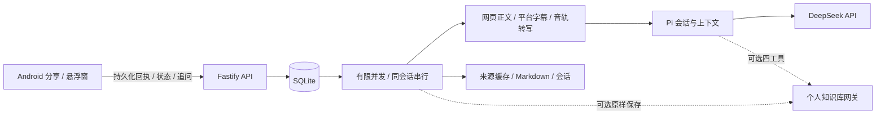

# Agent Bubble

[](https://github.com/Alex-tangt/agent-bubble/actions/workflows/ci.yml)
[](LICENSE)

**一个随手交办、后台处理的安卓阅读助手。** 分享文章或 B 站链接，在悬浮窗里查看总结，继续围绕同一份内容追问。

手机负责入口与阅读；你的电脑负责来源获取、任务执行和模型调用。收到后台回执后，离开页面、断网或结束手机应用不会取消已经接收的任务。

> 当前是个人工具 MVP。主要在 Windows 后端与 Android 15 真机验收；不承诺所有网站、视频和厂商系统都可用。网站验证、登录或访问限制会明确返回错误。

## 能做什么

- **安卓分享与浮窗入口**：收件匣、右上角新建、链接输入、可选任务要求、标题栏拖动、结果查看与追问、完整阅读及结果分享。
- **后台任务**：SQLite 先落盘后返回回执，稳定请求 ID 去重，取消、原会话重试、排队恢复；独立会话有限并发，同一会话按序执行。
- **文章获取**：HTTP / Readability 优先；需要渲染时使用独立 Electron / Playwright 浏览器，保存自己的登录状态，校验与缓存正文。
- **B 站视频**：优先平台字幕，不可用时获取选定 P 的公开音轨，采用 Qwen 异步转写或可选 faster-whisper 本地转写。保存时间戳、处理依据和来源范围。
- **会话管理**：复用 Pi SDK 的模型会话与上下文管理；已获取内容用于总结和追问，抓取与报错由程序处理。
- **可选个人知识库**：首次总结原样保存，保存失败独立重试；启用时提供 `memory_search/get/list/add` 四工具。默认关闭，需要自行部署兼容网关。
- **本机日常部署**：后台启动器、日志与故障恢复；手机通过私人 Tailscale HTTPS 连接，日常无需 USB。

尚未实现视频画面理解、通用手机操作、自主编码或跨应用自动读取正文。浮窗完成提示依赖服务仍在运行；关闭浮窗后仍可重新打开应用取回结果。

## 架构



模型 key 仅留在后端。手机使用独立服务连接凭据，并通过 Android Keystore 加密保存。Pi、ASR、浏览器与正文提取组件均为开源复用；本仓实现产品入口、任务状态、调度、来源校验和接入契约。

## 快速开始：后端

需要 **Node.js 24、npm**。网站渲染还需要图形环境；Windows 默认使用已安装 Chrome，知乎使用独立 Electron 会话。

```sh
git clone https://github.com/Alex-tangt/agent-bubble.git
cd agent-bubble
npm ci
```

首次复制 `.env.example` 为 `.env`（Windows：`Copy-Item .env.example .env`；Linux/macOS：`cp .env.example .env`），已有配置时不要覆盖。填写自己的凭据，不能照抄下面的占位文字：

```dotenv
DEEPSEEK_API_KEY=your-deepseek-key
AGENT_BUBBLE_TOKEN=your-long-random-service-token
```

服务凭据至少 24 字符，可在本机生成：

```sh
node -e "console.log(require('node:crypto').randomBytes(32).toString('hex'))"
npm run build
npm run host:start
npm run host:status
```

默认电脑入口是 `http://127.0.0.1:8787`，也提供网页客户端。其他常用命令：`npm run host:stop`、`npm run host:logs`。源码更改后先等任务结束，再停止、构建和启动。

`npm ci` 通常会安装 Electron；下载未完成时可运行 `npm run browser:install-electron`。没有 Chrome 时设置 `ARTICLE_BROWSER_CHANNEL=chromium` 并执行 `npx playwright install chromium`。无桌面的云主机并非当前完整验收环境。

Windows 可双击 `scripts/backend-start.cmd`、`backend-status.cmd`、`backend-stop.cmd`。登录后自启和桌面控制入口见[本机部署指南](docs/local-deployment.md)。每台机器使用自己的 `.env` 与 `data/`，仓库不提供模型 key 或网站账号。

## 构建与安装安卓

需要 **JDK 17+、Android SDK 35**。用 Android Studio 打开 `android/`，或配置 SDK 后使用仓库的 Gradle Wrapper：

```sh
cd android
./gradlew assembleDebug testDebugUnitTest lintDebug
```

Windows 使用 `gradlew.bat`。APK 位于 `android/app/build/outputs/apk/debug/app-debug.apk`，支持 Android 8.0+。这是调试签名包；正式签名和安装文件不放在源码仓库。

Windows 也可以用校验下载的独立工具链：

```powershell
powershell -ExecutionPolicy Bypass -File scripts/setup-android.ps1
powershell -ExecutionPolicy Bypass -File scripts/build-android.ps1
```

成功的 GitHub Actions Android 构建会提供 `agent-bubble-debug-apk` 临时 artifact，不同构建的调试签名可能不同；日常安装建议持续使用自己构建的同一签名。

## 手机无线连接

1. 电脑和手机安装 Tailscale，登录同一个账号并保持连接。
2. 后端启动后，在电脑执行 `scripts/remote-access.ps1`；首次按账号页面提示启用 Serve / HTTPS。
3. 手机 Agent Bubble「连接设置」使用命令输出的**真实 HTTPS 地址**，连接凭据填写自己的 `AGENT_BUBBLE_TOKEN`。手机不需要模型 API key。
4. 首次开启浮窗，授权系统悬浮权限后返回应用再次开启；通知权限用于完成提醒。

日常不依赖 USB。详细步骤及移动数据验收见[手机无线连接指南](docs/phone-wireless-setup.md)。仅开发调试时可用 `adb reverse tcp:8787 tcp:8787`，手机地址 `http://127.0.0.1:8787`；模拟器使用 `http://10.0.2.2:8787`。这两个地址不能作为外出访问地址。

## 视频与网站登录

B 站读取和音轨下载需要 **Python 3.10+、yt-dlp**：

```powershell
powershell -ExecutionPolicy Bypass -File scripts/setup-media.ps1 -Python 'python.exe'
```

字幕优先。需要云端转写时在 `.env` 填 `DASHSCOPE_API_KEY`；默认模型为 `qwen-audio-3.0-asr-flash-filetrans`，北京地域端点。选择本地转写时设 `ASR_PROVIDER=local` 并执行 `scripts/setup-asr.ps1`，首次准备会下载模型。具体限制、时长校验及实际测点见[B 站工作流](docs/bilibili-workflow-research-2026-10-09.md)与[转写验收](docs/qwen-asr-validation.md)。

仅支持普通 BV / av 投稿与一个选定 P，`?p=N` 指定 P；不自动处理整套课程。字幕不可见不能直接判定视频无字幕。云端转写失败明确报错，不静默改为慢速本地转写。

网站需要验证或登录时，在后端网页的连接设置打开专用浏览器，或执行：

```sh
npm run browser:login -- --site=zhihu
npm run browser:login -- --finish
npm run bilibili:login
npm run bilibili:login -- --finish
```

手动完成后关闭登录窗口，在原会话重试。登录只属于你自己的后台会话，不继承手机或日常浏览器登录。访问限制无法保证通过登录解除。

## 验证与贡献

```sh
npm run build
npm test
npm run test:host
python scripts/audit-secrets.py
```

上述自动化测试不调用付费模型。带 `test:live`、`test:articles`、`test:videos`、`test:qwen` 的脚本用于实际网站 / 模型验收，可能需要登录并产生 API 用量，细节见脚本与历史记录。真实模型、来源缓存、无缓存获取、模拟服务和手机手工操作的结果不能混为一类。

参见[参与开发](CONTRIBUTING.md)、[安全与数据边界](SECURITY.md)、[知识库接入](docs/knowledge-base-integration.md)。历史验收记录保留原环境与未完成项；部分本机资料不随公开仓库分发。

## 许可证与致谢

[MIT](LICENSE)。第三方组件保留原许可证，详见[第三方说明](THIRD_PARTY_NOTICES.md)。感谢 Pi、Mozilla Readability、Playwright、Electron、yt-dlp、faster-whisper 与 AndroidX / Compose 社区。项目使用 AI 辅助开发与验证。
