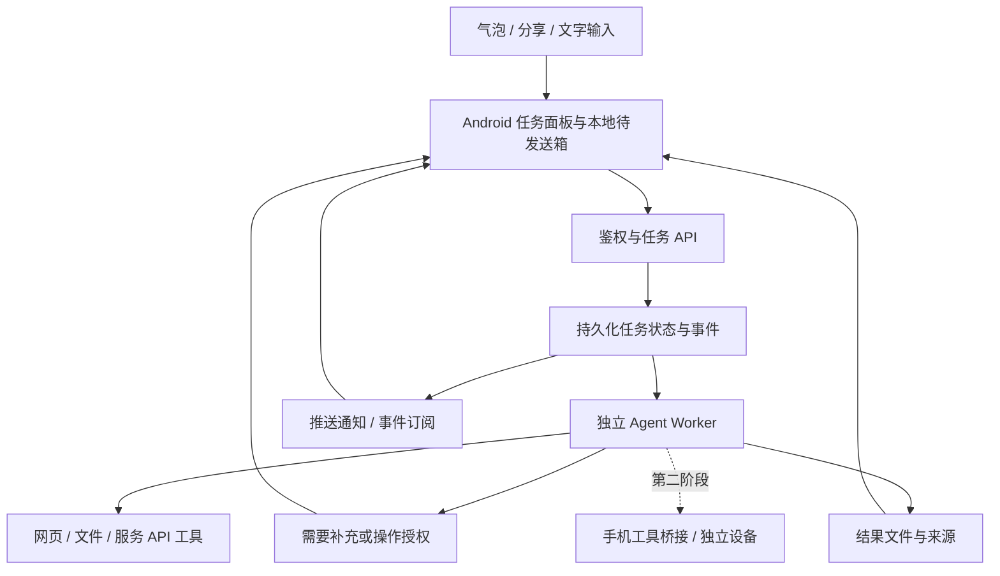

# Android AI 悬浮窗：产品形态、技术边界与开发规划

> 2026-10-08 范围更新：用户明确这是自用工具，首批总结文章与 B 站视频，并优先复用现成 Personal Agent 内核。首版以 [自用架构与框架选择](personal-agent-architecture.md) 为准；本文中的通用任务平台、独立 Worker 与扩展路线不再作为首版必选项。

调研日期：2026-10-07（中国标准时间）。本稿基于 Android/Google Play 官方资料、开源项目的一手仓库；未安装 APK、未做真机运行测试。官方事实在段落旁附来源；产品取舍、工期和验收阈值属于规划建议。社区方案的许可证与维护核验见 [社区调研](community-research.md)。

## 1. 推荐方向

把产品定位成 **随时可唤起的 Agent 任务入口**：用户在任意 App 中交任务、补充上下文，Agent 在服务器或用户自己的电脑上执行，手机展示进度、接收待处理事项与结果。核心体验是“交出去以后不用盯着”，任务卡片应成为主界面，聊天作为创建和修改任务的方式。

建议先做 **云端/自托管执行 + Android 原生悬浮入口**，保留手机工具接口；在第二阶段加入系统 Intent/API 能完成的本地动作；通用手机 GUI Agent 单独验证。暂按面向个人用户、普通第三方 APK、没有 Root/OEM 特权、需要兼容国内手机的前提规划。云端也可以是用户的 NAS、电脑或自托管服务器，不强制意味着厂商托管。

| 执行方式 | 适合任务 | 手机熄屏后继续 | 可继续使用其他 App | 建议阶段 |
|---|---|---|---|---|
| 服务器/电脑的工具与浏览器 | 检索、资料整理、文件处理、授权服务 API | 服务器已持久化接收任务且运行正常时可以 | 可以 | 首版主线 |
| 手机系统 Intent/API | 打开地图、创建日历事件草稿、选文件、分享结果 | 取决于 API，交互动作可能需要用户回到界面 | 多数短动作可以，不能一概保证 | 第二阶段 |
| 手机无障碍/ADB GUI 控制 | 在缺乏 API 的 App 中点击、输入、翻页 | 普通 APK 不宜承诺 | 通常争用当前界面和输入 | 独立实验 |
| 云手机/独立设备 GUI 控制 | 必须操作 Android App，但不能占用主手机 | 远程设备可独立运行 | 主手机可以继续使用 | 有明确需求再验证 |
| OEM 系统助手的 Computer Control | 在受控后台虚拟显示中操作目标 App | 需按设备和会话条件验证 | 系统提供隔离执行能力 | OEM 合作路线 |

表中后三项的适用判断是工程推论；Android 官方明确说明无障碍手势会取消正在进行的其他手势，而 Computer Control 的后台虚拟显示能力面向 OEM 预装助手，要求特权权限。不能把系统助手的能力直接套用到普通 APK。[无障碍手势 API](https://developer.android.com/reference/android/accessibilityservice/AccessibilityService#dispatchGesture(android.accessibilityservice.GestureDescription,android.accessibilityservice.AccessibilityService.GestureResultCallback,android.os.Handler))、[Computer Control](https://developer.android.com/ai/computer-control)

## 2. 产品形态

### 2.1 三层界面

1. **悬浮入口**：约 48–56 dp 的可拖拽气泡，自动吸附屏幕边缘；闲置时弱化显示。只表达正在运行、需要处理、已完成等状态和任务数量。支持临时隐藏、退出与通知入口恢复。
2. **轻量任务面板**：点击展开，输入一句话，可附上用户分享的文字、链接、图片或文件；显示本次会交给 Agent 的材料。提交后可以立即收起。若任务缺少必要条件，只追问最影响结果的一项。
3. **完整任务中心**：管理并行任务、结果文件、来源、执行记录、授权的服务、默认预算；复杂编辑和配置放在主 App。通知可直接进入相应任务。

展开面板中优先展示“正在做什么、缺什么、结果在哪里”，不连续滚动展示长篇模型推理，不用没有依据的百分比表示开放式任务进度。运行阶段可写成“读取材料 → 检索来源 → 整理结果”；点击查看工具活动摘要与证据。

### 2.2 首版最有价值的三个场景

| 场景 | 用户输入 | Agent 真正需要执行 | 交付物 |
|---|---|---|---|
| 阅读后委托 | 分享文章链接：“提炼 5 点，核验关键说法” | 获取正文、搜索一手来源、整理 | 带来源的摘要和核验结果 |
| 资料调研 | “调研 Android 悬浮窗方案，按可集成性比较” | 多来源搜索、比较、归档 | 表格、建议与 Markdown 文件 |
| 文件处理 | 选择会议材料：“提取行动项，标出缺失信息” | 上传指定文件、解析、生成结果 | 行动项清单或结构化文件 |

这三个场景是首版假设，正式实现前应拿 10–20 个真实任务验证频率和价值。付费服务、账号登录、网页限制及文件格式支持会影响可用性，首版需要列出实际支持的工具。

### 2.3 一次任务的闭环

用户分享材料/点气泡 → 填任务 → 确认本次材料及执行位置 → 服务端持久化接收 → 返回任务卡 → 后台执行 → 必要时请求补充或操作授权 → 完成通知 → 查看结果/导出/继续修改。

手机断网或进程终止时，已被服务端接收的云任务继续；尚未提交的内容保存在本地待发送箱，恢复网络后按幂等键提交。客户端只有收到持久化接收回执才显示“已交给 Agent”，不能仅凭本地生成任务 ID 就承诺执行。

多任务之间可并行，但手机 GUI 同时只允许一个执行会话。用户触碰屏幕、锁屏、权限失效时应暂停手机控制并提示接管；云端任务保持独立。

### 2.4 结果与继续对话

悬浮面板增加独立的结果页：任务名、结果摘要、来源与交付文件，下方提供“继续这个任务”的输入区。完成通知点击后进入对应结果；收起后再次打开保留任务上下文。解释、改写等追问优先复用已有材料；需要补查时创建新的执行记录与结果版本，保留原结果。

会话、任务、执行记录和结果版本需要分别建模；暂停任务的补充/授权与已完成任务的正常追问也需要不同处理。harness、爬虫、模型凭据和部署位置的具体设计见 [后端执行设计](backend-execution-design.md)。

## 3. Android 平台事实与产品影响

### 3.1 悬浮窗有三条不同路线

| 路线 | 官方事实 | 对产品的取舍 |
|---|---|---|
| `TYPE_APPLICATION_OVERLAY` | API 26 起提供；需要 `SYSTEM_ALERT_WINDOW`，层级低于关键系统窗口，系统可改变其位置、尺寸或可见性 | 适合跨旧版系统统一实现自定义气泡；需要用户授予特殊访问权限及 OEM 实测 |
| Notification Bubbles | 对 target Android 11+ 的通知有会话条件；用户及系统控制其显示 | 可用于符合条件的会话，不能当成任意任务气泡的必然入口 |
| Android 17 App Bubbles | 用户可从启动器把符合多窗口要求的 App 变成气泡 | Android 17 上值得优先适配的系统入口；不能假设覆盖所有旧设备及厂商启动器 |

来源：[Overlay API](https://developer.android.com/reference/android/view/WindowManager.LayoutParams#TYPE_APPLICATION_OVERLAY)、[Notification Bubbles](https://developer.android.com/develop/ui/compose/notifications/bubbles)、[App Bubbles 要求](https://developer.android.com/develop/adaptive-apps/guides/support-bubbles)。Android 17 已于 2026-06-16 发布，因此本项目不能只按 Android 14/15 的资料设计。[官方发布说明](https://developer.android.com/blog/posts/android-17-is-here)

建议把气泡外壳和任务面板解耦，同一任务面板可以装进 Overlay、普通 Activity 和系统 App Bubble。首个技术验证同时测系统气泡与自定义悬浮窗，再按目标机型覆盖选择默认入口；用户拒绝悬浮权限时仍可通过分享、快捷入口和通知使用核心功能。

### 3.2 长任务放在哪里运行

- Android 12 起后台启动前台服务受到限制。target Android 15+ 时，依靠悬浮窗权限使用相关豁免，还要求有可见 Overlay；有权限本身不等于可以随时启动。[后台启动限制](https://developer.android.com/develop/background-work/services/fgs/restrictions-bg-start)
- target Android 15+ 的 `dataSync` / `mediaProcessing` 前台服务分别有后台 24 小时累计 6 小时限制；这不是所有前台服务的统一时限。[前台服务超时](https://developer.android.com/develop/background-work/services/fgs/timeout)
- Android 16 起，通过前台服务启动的后台作业同样受作业配额约束，包括 WorkManager 作业。[前台服务版本变化](https://developer.android.com/develop/background-work/services/fgs/changes)
- `specialUse` 可覆盖其他合法前台服务用例，但需描述具体用途，并接受 Play 审核；不能作为任意保活的通行证。[前台服务类型](https://developer.android.com/develop/background-work/services/fgs/service-types#special-use)

**规划判断**：云端任务的存活不能依赖手机常驻服务或长连接。WorkManager 用于可靠提交、补发及同步，不能保证 Agent 在手机上无限即时运行。面板可见时订阅事件；不可见时停止不必要的连接，结果通过推送/重新打开时查询恢复。自定义气泡本身如需前台服务，应单独核验其真实服务类型和生命周期。

### 3.3 上下文与权限边界

- 优先用分享目标接收文字、链接、图片和文件；系统会按声明的 Action/MIME 展示分享入口。[接收分享内容](https://developer.android.com/develop/ui/compose/sharing/receive)
- 可加入选中文本菜单，但依赖来源 App 是否提供选文本/处理菜单，不能保证所有 App 通用。[`ACTION_PROCESS_TEXT`](https://developer.android.com/reference/android/content/Intent#ACTION_PROCESS_TEXT)
- Android 10+ 除默认输入法或当前获得焦点的 App 外，不能访问剪贴板。产品应提供显式粘贴，不承诺后台实时监听全部复制内容。[剪贴板限制](https://developer.android.com/about/versions/10/privacy/changes#clipboard-data)
- MediaProjection 每个录屏会话需要用户同意；Android 14+ 的授权 token 不能反复创建会话。Android 15 QPR1+ 锁屏会自动停止投屏。[MediaProjection](https://developer.android.com/media/grow/media-projection)
- 无障碍服务可以在具备配置和授权条件下读取窗口节点、分发手势、截屏，但并不保证所有 App 都有可用语义树或所有页面都能捕获。[AccessibilityService](https://developer.android.com/reference/android/accessibilityservice/AccessibilityService)
- target Android 17+ 直接访问局域网需处理 `ACCESS_LOCAL_NETWORK` 或使用系统中介的选取方式。若产品连接 NAS/电脑 Agent，应把这项纳入接入设计。[局域网权限](https://developer.android.com/privacy-and-security/local-network-permission)

建议按使用时机请求权限：提交文字任务不需要先申请无障碍、录屏、麦克风；选文件走系统选择器；按住说话时才申请麦克风；截图上传前显示选取内容。首版不做持续监听全屏/通知的隐式记忆。

### 3.4 手机 GUI 与应用市场分发

Google Play 当前无障碍自动化指引禁止普通 App 使用该 API 自主发起、规划、执行动作或决策；静态、用户定义的确定性规则脚本与经过核实、以残障辅助为核心的工具有不同适用条件。不能把“用户点了一次执行”或“增加确认按钮”推定为通用 GUI Agent 已满足 Play 政策。[Google Play 原文](https://support.google.com/googleplay/android-developer/answer/10964491?hl=en)

规划上分两条能力路线：公开市场版本优先云端工具和明确系统 API；自用/实验分发版本可以验证无障碍、Shizuku、ADB 等手机执行方式，但仍受 Android 权限、OEM 行为与目标服务规则限制。侧载不等于系统权限，也不自动解决可靠性。

若面向海外侧载分发，Android 开发者验证也需纳入发布核查：官方当前列出 2026-09-30 起在巴西、印度尼西亚、新加坡、泰国的认证设备及参与商店先行实施；2027 起扩大。不要把这一地区计划写成当前全球或中国所有 APK 都已统一受限。[开发者验证](https://developer.android.com/developer-verification)

### 3.5 系统级 Agent 的新方向

**AppFunctions / Android MCP**：Android 16+ 的平台 API 与 Jetpack 库，允许 App 把本地功能暴露给获得权限的调用方。当前仍为实验预览，端到端管线只开放给有限 App 和系统 Agent，报名 EAP 不自动获得接入资格。适合作为后续合作方向，不应成为普通 APK 的首版关键依赖。[AppFunctions 与 FAQ](https://developer.android.com/ai/appfunctions)

**Android Computer Control**：允许 OEM 预装助手在安全后台虚拟显示中操作目标 App，要求特权 `ACCESS_COMPUTER_CONTROL` 和会话授权，当前目标 App 支持有限。它说明真正不占用主屏的本地 GUI 自动化有系统级路线，但不意味着普通开发者已经拥有通用执行权限。[Computer Control](https://developer.android.com/ai/computer-control)

## 4. 社区方案选型摘要

| 方案 | 类型与可借鉴部分 | 主要限制 | 本项目建议 |
|---|---|---|---|
| [Operit](https://github.com/AAswordman/Operit) | 完整 Android Agent；悬浮窗、气泡、任务工作区、工具权限与多种执行模式 | 主代码 LGPL-3.0-only，依赖/模板许可另查；构建涉及外部资源与子模块；虚拟显示需匹配权限和设备 | 第一优先参考产品与原生实现结构；自用可先体验现成 APK，商业产品先核查许可与耦合度 |
| [DroidRun / Mobilerun](https://github.com/droidrun/mobilerun) | Python 手机 Agent + Android Portal；节点观察、点击输入、任务执行闭环 | 框架 MIT，但 [Portal](https://github.com/droidrun/mobilerun-portal/blob/main/LICENSE) 为 AGPL-3.0-or-later；主框架不是可直接嵌入 APK 的 Android SDK | 第二阶段手机 GUI 实验的候选；分别评估框架和 Portal 的集成方式 |
| [Open-AutoGLM](https://github.com/zai-org/Open-AutoGLM) | 手机视觉 Agent；截图、推理、动作、ADB/HDC 等驱动链路 | 主框架 [Apache-2.0](https://github.com/zai-org/Open-AutoGLM/blob/main/LICENSE)，以 Python/外部控制为中心；模型权重及驱动组件许可另查；不是完整悬浮窗产品 | 学习动作协议、视觉控制和评测流程，不作为首版 Android 客户端底座 |
| [Shizuku](https://github.com/RikkaApps/Shizuku) / [Shizuku-API](https://github.com/RikkaApps/Shizuku-API) | 帮普通 App 通过 ADB/Root 启动的进程调用系统 API；提供权限执行层 | 管理器 Apache-2.0，客户端 API MIT；需要启动/授权并处理失效；不是 Agent，也不是任意系统特权 | 作为实验性手机工具的可选依赖，不让首版安装流程依赖它 |
| [LangGraph](https://github.com/langchain-ai/langgraph) | MIT 的有状态 Agent 编排；持久化、暂停与人工介入 | 不提供 Android 悬浮 UI，也不替代任务服务、执行隔离和外部操作幂等 | 云端 Worker 的优先候选，先验证故障恢复再采用 |

表中的“优先”是基于本产品目标的选择，未做性能跑分或真机成功率排名；许可证名称并不自动等于可以直接复制整库。完整来源、更多候选及维护日期的核验边界见 [社区调研](community-research.md)。

建议组合：**独立的 Kotlin 客户端 + 可自托管任务服务 + LangGraph/有限工具循环 + 后续手机工具桥接**。若只是个人自用，先体验 Operit 可以快速判断真实需求；若开发自己的产品，先复用交互经验和协议边界，再选择具体代码模块。

## 5. 技术架构建议

以下是工程选择，不是现成社区方案的安装步骤。

### 5.1 Android 客户端

- Kotlin + Jetpack Compose；Overlay 外壳用 WindowManager，面板状态和完整 Activity 共享任务模型。
- Room 持久化任务镜像和待发送箱，DataStore 保存设置；进程重建恢复状态。
- 前台可见时使用 SSE 或 WebSocket 接收事件；断线凭任务 ID 与事件游标补拉。连接不是任务执行的依赖。
- WorkManager 处理可靠提交、短时上传/补发和结果同步；根据实际文件传输场景选择系统传输 API。
- PushProvider 抽象：海外可评估 FCM，国内按目标手机及分发条件评估厂商通道；不把“没有推送即时到达”当成“任务丢失”。
- 手机工具桥接单独模块，接口说明工具所需权限、执行位置、是否需要前台和可否取消；不让 Overlay UI 直接拥有任意工具权限。

### 5.2 后端

- FastAPI 可作为接口层候选；任务执行放在独立 Worker，不能用一次 HTTP 请求或 Web 框架的进程内后台回调承担长任务。
- PostgreSQL 保存任务、事件、权限引用、结果索引；初期可用数据库任务领取机制，负载增加后再引入消息队列。
- AgentRuntime 可评估 LangGraph 的检查点、暂停和恢复；也可以先做一套有限工具循环。框架检查点不能替代产品任务队列、认证、沙箱和副作用幂等。
- 文件放对象存储；处理用户文件/浏览器任务的执行器限定工具、目录、网络、时间和资源。
- 模型 Provider 与工具接口分开：模型负责理解和工具选择，权限与真正执行由服务控制。手机不携带厂商公共模型密钥；自带密钥模式需另行设计保存和转发路径。

LangGraph 的具体适用性与许可证核验记录见社区调研。后端组件还没有安装或验证，正式选型应由可恢复长任务的技术验证决定。

### 5.3 任务与操作语义

建议状态：`draft → submitting → queued → running → succeeded`；旁路包含 `waiting_for_user`、`paused`、`failed`、`cancel_requested`、`cancelled`。部分执行成功应在结果中明确记录，不伪装成完整成功。

最少记录：任务 ID、用户目标、上下文附件、执行位置、预算、工具权限范围、步骤与工具事件、结果文件、错误/待补充内容、创建与更新时间、版本/事件序号。

接口最小闭环：创建任务（幂等键）、查询任务、读取/订阅事件、补充材料、审批某次操作、请求取消、读取结果。审批绑定操作内容/参数/任务/有效期，参数变化需要重新核对；截图、网页与文件内容作为不可信材料，不能因此扩权。

“停止”采用协作式取消：等待模型/工具的安全停止点，记录已发生的操作；已经提交到外部服务的发送、删除等行为不会因按钮点击自动撤回。只读查询可以有限重试，外部写操作须有幂等或结果核对后再重试。

## 6. MVP 范围与开发路线

### 6.1 首版范围

做：可恢复的任务提交与状态、气泡/分享入口、文字与指定附件、3 类任务模板、执行记录、结果通知和文件、取消、补充信息、必要的操作审批、单任务时间/调用预算。

后续验证：语音入口、屏幕上下文、系统日历等本地工具、手机 GUI、多设备、持续记忆、自定义远程 MCP 工具。优先把 3 个常见任务做成可交付，再增加工具覆盖。

### 6.2 分阶段计划

| 阶段 | 目标 | 可评估交付物 | 进入下一阶段的条件 |
|---|---|---|---|
| 可行性验证，约 3–5 个工作日 | 比较自定义 Overlay 与 Android 17 系统气泡；证明云任务脱离手机运行 | 2–3 个目标真机上的入口 Demo；一个运行数分钟的可恢复服务器任务 | 手机进程终止后任务仍完成；重开可恢复结果；输入/键盘与收起流程正常 |
| 云端 MVP，约 4–6 人周 | 跑通上述 3 类任务 | 可安装 APK + 可自托管服务 + 任务与结果完整闭环 | 达到下面的首版指标，成本与失败可观测 |
| 本地工具扩展，约 2–4 人周 | 系统 Intent/API 和上下文能力 | 2–3 个明确手机工具与权限按需申请 | 权限拒绝/撤销/锁屏有清晰恢复行为 |
| 手机 GUI 专项验证，另行估算 | 在确定机型、App 和分发方式下验证 GUI Agent | 受限 App 白名单、接管流程、任务评测集 | 完成率和错误动作风险满足实际场景；不能凭公开视频判定 |

以上为开发量假设，不是交付承诺；不包含商业支付、全厂商适配、应用市场审核、训练模型或云手机规模部署。首版沿用现有模型和工具服务。

### 6.3 建议验收指标

这些是拟定阈值，尚无实测结果：

- 建立至少 30 个任务用例，按三个场景平均覆盖；常见任务独立完成率目标 ≥80%，记录人工接管和错误原因。
- 测试服务端已接收任务在客户端被终止、断网/重连后的完整恢复；重复提交不重复产生任务或外部副作用。
- 面板打开和收起在目标机上响应顺畅；提交回执目标 p95 ≤2 秒（不包含大附件上传和模型执行）。
- 工具请求与来源可追溯；伪造网页指令不能获得额外工具权限；授权等待状态可以恢复。
- 每次任务可统计模型调用、工具耗时、资源占用和实际成本；预算耗尽明确暂停或失败。
- Android 12–17 中按目标设备覆盖近期系统，至少包含一款 Pixel/标准 Android 与两款目标国内 OEM；测试锁屏、旋转、输入法、通知拒绝、悬浮权限撤销、服务被系统终止。
- 对 GUI 实验单列成功率、错误点击、误发送、恢复与接管时间；不能用云端摘要任务成功率替代 GUI 指标。

## 7. 决策记录与待验证项

当前建议：原生 Android 做入口；服务器/自托管 Worker 做长任务；任务卡片优先；云端工具首发；手机 GUI 插件化实验；Android 17 系统气泡一起验证；借鉴完整开源助手的交互与权限流程，但不在未审核许可证及耦合度前整库合并。

还需明确：最重要的 3 个真实任务、主要设备/Android 版本、Play 还是国内商店/自用 APK、厂商云端还是用户自托管、是否必须操控手机上的登录态。它们决定路线优先级，但不妨碍先做上述可行性验证。

需要真机才能确认：厂商气泡/Overlay 存活、焦点与输入法、敏感页面隐藏行为、推送到达、耗电、无障碍节点质量。需要固定版本后再确认：社区项目代码与依赖许可证、构建兼容性、模型许可证及服务使用条款。当前调研不宣称这些验证已通过。
