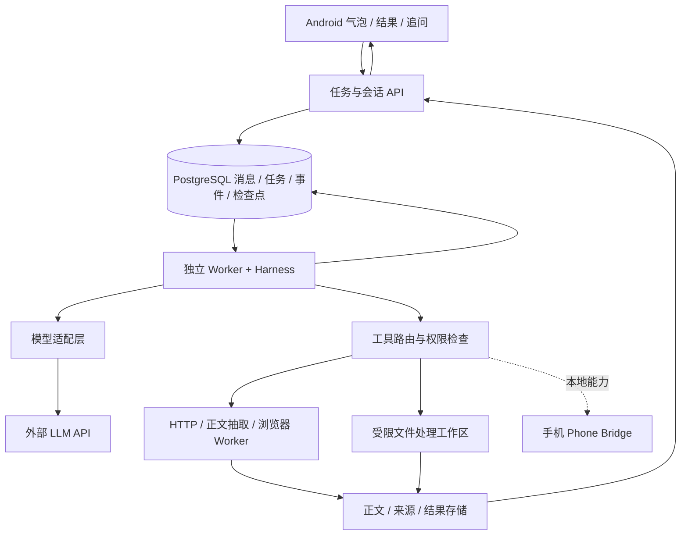

# Agent Bubble：结果对话与后端执行设计

> 2026-10-08 范围更新：首版采用自用 Personal Agent 入口方向，优先验证现成 Pi SDK，通过薄服务接入手机。当前首版架构见 [自用架构与框架选择](personal-agent-architecture.md)；下文的通用队列、LangGraph、独立 Worker 与 Postgres 为较大范围设计，非当前必选项。

日期：2026-10-07。承接 [产品规划](android-agent-product-plan.md)。本稿明确“结果后继续对话”和模型、harness、网页工具的运行边界；属于设计，尚未部署后端或接入真实模型。

## 1. 推荐部署

**手机运行交互与本地能力；服务器运行任务管理、harness 和网页工具；模型推理交给所选 API 提供商。** 自托管时，服务器也可以是用户自己的电脑/NAS。开发阶段先在本机启动同一套服务，Android 连到它；部署阶段迁到常开服务器，不需要把核心执行框架重写一遍。

模型使用远程 API 时，自己的服务器无需为模型推理配 GPU；服务器仍需要承担浏览器、文件处理、并发任务等 CPU/内存负载，资源配置应按真实任务压测。手机本地运行 harness 技术上可以做，但要适配 Android 的执行环境、生命周期、后台限制和浏览器能力；首版没有必要同时维护两套完整运行时。

| 部分 | 职责 | 首版运行位置 | 凭据 |
|---|---|---|---|
| Android 客户端 | 悬浮窗、输入、附件选择、结果、追问、通知、本地缓存 | 手机 | 本产品登录 token；按需获得 Android 权限 |
| 任务 API | 身份、会话、任务提交、结果读取、审批、事件 | 服务器 | 服务内部凭据，不暴露给 App |
| Harness / Agent Runtime | 上下文、模型调用、工具调度、检查点、预算、错误恢复、停止与交付 | 独立服务器 Worker | 通过模型适配层使用对应用户/服务的模型凭据 |
| LLM 推理 | 根据上下文生成回复或工具调用请求 | 模型提供商 | Provider API key |
| HTTP 抓取/正文抽取 | 请求网页并提取正文、元数据 | 服务器工具进程 | 公共网页通常不需要模型 key；目标 API 认证另算 |
| 浏览器自动化 | JavaScript 渲染、点击、分页、下载 | 服务器浏览器进程/容器 | 授权的站点会话；托管浏览器服务可能另需 key |
| 文件处理/脚本 | 解析已提供文件、格式转换、生成交付物 | 受限服务器执行环境 | 仅本次工作区和必要服务凭据 |
| Phone Bridge | 执行特定手机 Intent/API、文件选择等 | 手机 | 设备连接身份和本次工具权限 |

## 2. Harness 到底是什么

此处把 harness 定义为“包在模型周围、让它完成任务的运行程序”。它不是一把 API key，也不是一次 prompt；它管理下面这个可停止、可恢复的循环：

1. 从数据库读取本次目标、会话摘要、最近消息、所引用的结果/来源和可用工具。
2. 检查时间、调用、权限和取消状态，整理送给模型的上下文。
3. 经 Model Adapter 调用 LLM API。
4. 如果是工具请求，由 Tool Router 校验参数、执行位置与权限，并运行具体工具；工具结果和来源写入任务记录。
5. 把必要工具结果带入后续模型调用，直到交付、需要用户、预算耗尽或取消。
6. 保存结果版本，发布事件，通知客户端。等待用户时释放执行资源，下次根据持久状态恢复。

实际执行动作的是工具程序：模型输出 `read_page(url)` 不意味着模型供应商自动运行我们的浏览器。由 harness 接收调用请求，再调自己的 HTTP/浏览器工具；若采购托管抓取服务，则工具改为调用该服务 API。

实现建议：使用 LangGraph 做状态图与检查点；围绕它实现自己的任务服务、工具注册、预算和工作区。不要求使用厂商托管的 Agent Server，也不需要首版引入多 Agent 编排。LangGraph 的 checkpointer 用于会话状态；store 可用于跨会话信息。[官方持久化说明](https://docs.langchain.com/oss/python/langgraph/persistence)

LangGraph 支持等待外部输入后恢复，但需要持久 checkpointer 和稳定的 thread ID；恢复中断可能重新执行节点前半段。外部写操作要单独做幂等和结果核对。首版使用数据库持久化，不用进程内 MemorySaver 承诺重启恢复。[官方中断说明](https://docs.langchain.com/oss/python/langgraph/interrupts)

## 3. 爬虫、搜索与 AI 浏览器分层

“找页面”“读正文”“操作页面”是三种工具，不能用一项笼统的爬虫能力掩盖差别。

| 工具层 | 典型需求 | 候选实现 | 是否需要 LLM |
|---|---|---|---|
| 搜索 | 找到相关 URL、关键词检索 | 可切换的搜索 API / 授权搜索服务 | 搜索程序本身不必需要；检索词和筛选可由模型生成 |
| 页面抓取 | 给定 URL，读取可访问的 HTML | HTTPX | 不需要 |
| 正文抽取 | 从 HTML 去掉导航、广告等，抽出正文 | Trafilatura；或 Crawl4AI 的非 LLM 抽取 | 不需要 |
| 动态页面 | 渲染 JS、等待内容、确定性点击/分页 | Playwright + Chromium；或 Crawl4AI | 渲染和固定脚本不需要 |
| 自适应网页操作 | 不知道步骤，由模型观察页面决定下一动作 | 基于 Playwright 自建受限动作循环；复杂场景再评估 Browser Use | 决策需要模型；浏览器仍由工具执行 |

HTTPX 提供同步/异步 HTTP 请求；Trafilatura 提供正文和元数据提取；Crawl4AI 可自行运行，也有托管服务，包含非 LLM 与 LLM 抽取方式。因此“使用爬虫”不必等于“购买一个爬虫 API key”，也不必每次抓页都调用模型。[HTTPX](https://www.python-httpx.org/)、[Trafilatura](https://trafilatura.readthedocs.io/en/latest/)、[Crawl4AI](https://docs.crawl4ai.com/)

建议按任务类型直接调用抓取或浏览器工具；抓取遇到需要渲染的页面，再使用浏览器。动态页面不能抓取时返回具体原因，不能让模型编造正文。首版把“指定链接读取”和“资料检索”做稳，再增加开放式网页操作；不需要一开始对所有网页操作都使用视觉模型。

网页工具返回统一数据：原 URL、最终 URL、标题、获取时间、正文/结构化数据、来源 ID、截图/下载文件引用、是否截断，以及失败原因。原文和下载文件保存在结果存储，送给模型的通常是选出的片段与引用，避免把海量网页重复塞入上下文。

浏览器会话按用户隔离；任务之间默认使用独立 BrowserContext。登录态明确授权后可按“用户 + 站点”恢复，但不能跨用户共享。BrowserContext 隔离 cookies/storage，不是进程或安全边界；资源和执行隔离仍由浏览器 Worker/容器实现。[Playwright BrowserContext](https://playwright.dev/docs/browser-contexts)

登录、验证码或需要人工确认的页面应进入等待用户状态；支付、发送和删除等外部动作按工具权限处理。云端浏览器不会自动拥有手机浏览器或手机 App 的登录态。如果任务必须使用手机上的会话或本地能力，路由到 Phone Bridge/独立设备实验，而不是假设把任务移到云端就能访问。

## 4. 结果页面与继续对话

### 4.1 悬浮窗里的结果页

新增一个与任务创建页、执行页相接的结果页：上方显示任务名、完成状态和结果版本；中间显示摘要、来源和交付文件；下方固定为“继续这个任务”的输入区。长文/大量文件转到完整任务中心，悬浮页保持轻量。

完成通知由用户点击后进入对应结果页；气泡显示待查看完成状态。已经查看或收起后仍可回到同一任务，不能回到空白对话。新执行产生结果 v2 时，保留 v1，允许查看两次结果的变化。示例快捷追问包括“解释第二点”“改成表格”“再找三个方案”。

### 4.2 三类后续消息

| 用户消息 | 系统处理 | 是否重新跑爬虫 |
|---|---|---|
| “解释第二点”“缩短一点” | 带着所选结果和已有证据调用模型，回复或生成新版本 | 通常不需要；已有证据不足时说明并可提出补查 |
| “再找三个方案”“核验最新版本” | 在同一会话创建新的 Run，使用原任务材料与新目标执行工具 | 需要新增检索时才运行 |
| “批准这次发送”“这是缺少的文件” | 校验对应等待事件，恢复原执行 | 取决于被暂停的步骤 |

**已完成任务的正常追问**与**暂停任务的恢复输入**是不同操作。LangGraph 中前者向同一 thread 添加普通输入，后者才使用中断恢复机制，不能把所有聊天消息都当成 `resume`。实现时固定库版本核对接口。[LangGraph 中断与多轮输入说明](https://docs.langchain.com/oss/python/langgraph/interrupts)

修改现有交付物时，在原 Task 下创建新 Run；独立的新目标可以建立新 Task。首版一个会话同时只允许一个写状态的 Run；运行中追加要求放入持久消息队列，在安全检查点处理或结束后接着执行，不让两次运行无约束覆盖同一上下文。不同会话可以并行。

## 5. 数据模型与最小 API

| 实体 | 用途 |
|---|---|
| Conversation / Thread | 一条可继续的对话，持有目标背景、摘要与当前任务指针 |
| Message | 用户输入、回复、附件和所针对的结果/任务引用 |
| Task | 一个有交付目标的委托，可包含多次执行 |
| Run | 一次执行；包含状态、预算、模型配置引用、检查点、取消请求与错误 |
| ToolCall / Event | 工具请求与结果、审批请求、阶段变化；事件具有单调序号 |
| Artifact | 不可变的结果文件或结构化结果版本，关联 Task/Run |
| Source | 页面正文/获取时间/URL 等证据，允许后续追问使用与核验 |
| CredentialRef | 模型、搜索、站点等凭据引用；与模型上下文分开 |

在单 Agent 图的首版，Conversation ID 可以映射为 LangGraph thread ID，按会话串行执行；产品 Task/Run ID 仍需独立存在，用于任务状态、版本和事件。恢复不能仅靠把全部聊天记录重新发送给模型：需要会话摘要、所选结果、证据引用和实际执行状态。

最小 API 建议：

- `POST /conversations`：新建会话。
- `POST /conversations/{id}/messages`：提交任务或追问，带幂等键、目标 Task/Artifact 引用。
- `GET /conversations/{id}`：恢复消息、任务和当前结果。
- `GET /runs/{id}`：查询运行状态。
- `GET /runs/{id}/events?after=...`：SSE/事件补拉，断线后从游标恢复。
- `POST /runs/{id}/cancel`：请求协作式取消。
- `POST /runs/{id}/responses`：回答某次补充/审批事件。
- `GET /artifacts/{id}`：读取元数据或取得受限结果链接。

统一消息入口先把输入持久化并返回回执；回复最终由事件流或推送交付，不能让手机等待一个可能长达数分钟的普通 HTTP 请求。快问快答也记录为一次可追踪执行，只是通常没有工具调用。

## 6. API key 与其他凭据

支持两种模型配置：产品提供模型服务，或用户填自己的 key（BYOK）。harness 在服务器执行时，服务器必须通过所选提供商的认证路径调用 API，常见方式是后端代持/使用用户 key；这项数据流要在配置界面说明。只把 key 留在手机并让手机转发模型请求，会使远程任务再次依赖手机在线，首版不采用这一执行方式。

产品共享 key 不打包进 APK。用户 key 通过 TLS 提交到可信后端，在密钥服务或加密存储中管理，并支持替换、删除；运行时只给 Model Adapter 使用，业务记录存引用和费用，不写入日志、模型 prompt 或网页工具环境。自托管用户可由自己的服务器保存 key，不一定交给产品厂商服务器。

分开保存模型 key、搜索 API key、托管浏览器/抓取服务 key、站点 OAuth/session。它们互不替代。站点登录态、用户文件与来源材料也需有明确作用域和保留策略。首版不让网页内容改变可用工具或权限；文件/浏览器执行环境不携带全部用户凭据。

## 7. 首版部署与模块边界

初期一台服务器即可运行多个分开的进程/容器：FastAPI、Agent Worker、按需浏览器 Worker、PostgreSQL。结果可以先用明确持久卷保存，接口抽象为 ArtifactStore，后续迁到对象存储。开发本机与云端采用同一容器配置，不直接把运行中浏览器放进 API 进程。

任务先由 PostgreSQL 持久记录并领取，Worker 有租约/心跳和异常恢复；并发量增加后再引入独立队列。浏览器按需创建并设置并发、内存、页数、下载量与超时；等待用户时不无限保留浏览器进程。重新恢复时从明确检查点重建必要上下文。

建议代码模块：`api`（产品 API）、`domain`（会话/任务/结果模型）、`runtime`（harness）、`models`（Provider Adapter）、`tools/web`、`tools/files`、`tools/device`、`storage`（状态/结果/凭据）、`workers`（任务领取与执行）。首版没有必要拆成大量独立微服务，这些边界可以先在同一后端仓库内实现。

本地手机执行只承担明确需要设备的动作。Worker 发出带身份、过期时间、权限范围和幂等标识的设备操作；设备不可用时进入等待设备状态，恢复连接后重新核验再执行。手机无法后台即时响应时，云端仍可完成独立的网页/文件步骤，不能承诺远程随时唤醒手机执行所有操作。

Android 的长时 WorkManager 作业仍需依赖前台服务，Android 16 起还涉及作业配额，因此这里把可持续的长任务放在服务器；手机负责可靠提交、短时传输和同步。[Android 长时 Worker 官方说明](https://developer.android.com/develop/background-work/background-tasks/persistent/how-to/long-running)

## 8. 开发验证顺序

1. 提交任务 → 持久回执 → Worker 调用模型 → 结果页 → 同任务追问，先用一个只读网页工具。
2. 加入抓取与正文抽取，保存来源；验证“解释”复用材料、“补查”才触发新工具运行。
3. 加动态浏览器；验证两用户的 cookies/文件不混用、浏览器失败不影响 API 服务。
4. 验证手机进程终止、Worker 重启、重复提交、执行中追问、停止与结果版本恢复。
5. 最后接 Phone Bridge；逐项验证设备离线、权限撤销与人工接管。

本轮已经更新概念草图的结果、追问和继续执行流程；还没有运行上述真实端到端验证，也没有安装这里列出的后端依赖。
