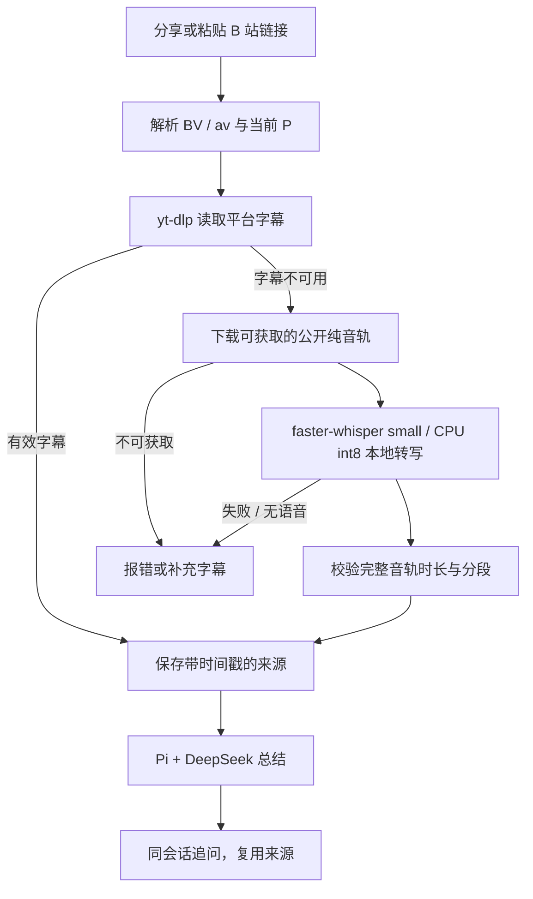

# B 站视频工作流验收

日期：2026-10-09。调研依据见 [工作流研究](bilibili-workflow-research-2026-10-09.md)。本轮在 Windows 个人电脑后端实现和验证，手机现有 APK 保持兼容。

最新更新：用户提供 Qwen 凭据后，已接入 `qwen-audio-3.0-asr-flash-filetrans`，无可用字幕时默认云端转写。完整 10 分钟音轨两次首次获取全文为约 17 / 21 秒。下面保留登录 / 本地 ASR 阶段记录，最新状态及 55 项测试见 [Qwen 云端验收](qwen-asr-validation.md)。

## 登录与并发更新

已打开项目专用 B 站 Chrome，检测到登录 Cookie 并保存后自动关闭。登录帮助程序默认 5 分钟期限，可直接关闭窗口或运行 `npm run bilibili:login -- --finish` 提前退出；`--status` 查看状态。仅导出这个专用 profile 中 B 站域名的 Cookie，后台每次读取时自动发现，无需重启，也不会暂停其他任务。

登录后的真实提取不经过来源缓存，且关闭 ASR 后运行：

| 视频 | 方法 | 字符 / 段 | 首次取得全文 | 元数据 / 字幕阶段 |
|---|---|---|---|---|
| 开源工具视频 | 平台中文字幕 | 5,956 / 315 | 3,958 ms | 3,871 / 5 ms |
| Harness 第 1 P | 平台中文字幕 | 14,790 / 758 | 3,065 ms | 3,048 / 5 ms |

两条字幕最后分段均覆盖到结尾；随后复用这两份字幕验证真实总结与原会话追问，两条均通过。获取全文时间不含 LLM。报告目录 `data/video-validation/2026-10-09T03-28-08-187Z/` 的复测 `acquisitionMs=3` 是缓存读取，首次完整取得时间见 `originalAcquisitionMs`，阶段细分见 `processingMs`。

默认允许 3 个独立会话并发，同一会话的任务按接收顺序执行；未缓存视频获取一次一个，获取完成即释放视频槽位。转写期间独立文章 / 已有来源追问可以执行，排在另一个视频后面的文章也能被调度。单条无字幕视频的 CPU 识别耗时不会因为队列并发而缩短；后续已接入 Qwen 云端 ASR，见上方最新更新。

回归测试先复现“视频尚未完成时文章始终排队”：修改前 `Task did not settle`，修改后文章在视频等待门未释放时已完成。覆盖同会话顺序、视频单并发、取消互不干扰和关闭服务中断所有活动任务，后端 **46 / 46** 通过，TypeScript 编译通过。新来源还记录下载、转写及 Python 模型加载 / 音频准备 / 识别耗时，后续可据此决定是否接入云端 ASR。

登录后首次新交办可将已有 ASR 来源升级为平台字幕，原转写保存到私有 `sources/archive/`。同一登录状态只尝试一次字幕升级，失败时复用原转写，不再执行 ASR。历史总结结果保留。

手机所连接的正常服务已更新，并直接通过 HTTP 提交原链接，让服务自行检查登录状态、取得字幕、升级缓存和总结；没有预先导入这次字幕。两条均完成真实总结和原会话追问，随后核对平台字幕全文 SHA-256 与来源方法：

| 视频 | 新的正常服务会话 | 提交至总结完成 | 再完成一次追问的总耗时 |
|---|---|---|---|
| 开源工具 | `2ca25844-ffad-42ff-9917-29015d7c6b4f` | 6,106 ms | 7,681 ms |
| Harness 第 1 P | `d5a637ee-643d-44d0-a4b8-5302383666e2` | 5,720 ms | 7,312 ms |

数字为本机本次后端 HTTP 验收，不保证其他视频 / 网络 / 模型请求相同。手机当前约每 4 秒刷新，界面显示会有额外刷新等待。两个新会话在手机最近任务可见。最终 `/health` 正常、队列为空、手机 `DEVICE_SERIAL` 的 `tcp:8787` USB 转发有效，现有 APK 无需重装。

最新私人报告：上述新目录下的 `production-user-open-source-report.json`、`production-user-harness-p1-report.json`。平台自动字幕也可能存在术语误听，不能把“取得平台字幕”理解为逐字准确；这两条“有字幕 / 无字幕”的初始猜测现已统一为登录后有可用中文字幕。

下面保留首轮匿名 ASR 验收，不能将它当成登录后的当前路径。

## 已实现的流程



程序负责获取、确定分 P、下载、转写、缓存、进度、取消、超时与错误分类；总结模型只收到已经取得的文本。ASR 是固定的专用模型程序，不依赖 LLM 决定下载或转写步骤。

字幕优先，排除弹幕，优先人工中文 / 平台中文自动字幕。修复了原命令没有启用 `--write-subs` 的问题。字幕登录不可见、无可用字幕、读取失败分别标注，符合降级条件时自动转写公开音轨。

## 两条用户原视频的结果

| 项目 | 开源录屏工具视频 | Harness 教程第 1 P |
|---|---|---|
| 链接 | [BV1t2HQ6EEaD](https://www.bilibili.com/video/BV1t2HQ6EEaD/?p=1) | [BV1jXHC6GEke?p=1](https://www.bilibili.com/video/BV1jXHC6GEke/?p=1) |
| 原视频标题 / 当前 P | 耗时两个月，烧掉100亿Token，我终于把它开源了！ | p01：Agent 七大架构场景化选型 + 完整落地 |
| 当前音轨时长 | 603.268 秒，约 10:03 | 1438.92 秒，约 23:59 |
| 匿名字幕访问 | 平台提示需要登录 | 平台提示需要登录 |
| 实际使用方法 | 本地音频转写 | 本地音频转写 |
| 保存分段 / 字符 | 338 段 / 6,055 字符 | 814 段 / 15,044 字符 |
| 最后分段结束时间 | 603.14 秒 | 1438.90 秒 |
| 首次取得全文耗时 | 192,513 ms，约 3:13 | 约 433,324 ms，约 7:13 |
| 真实总结 / 同会话追问 | 通过 | 通过 |

第二条视频的页面列表共 11 P，本次只获取第 1 P，不代表整个课程已经总结。链接中的 `p=N` 用于明确选定某一 P；没有 P 参数时默认第 1 P。

第二条第一次完整转写已经保存，但验收脚本把标题预期误写成“第1课”，实际第一 P 是“Agent 七大架构…”。修正为实际标题后复用同一份完整转写，继续验证总结与追问。报告中复测的 `acquisitionMs=4` 是缓存读取时间；`originalAcquisitionMs=433324` 根据来源开始时间与首次文件保存时间计算，不能把 4 ms 说成 24 分钟音轨的转写速度。

## 手机所连接的正常服务验证

后端已重新编译并更新，地址仍是 `http://127.0.0.1:8787`。更新前确认没有运行或排队任务。

两份已完成的转写缓存已复制到正常服务的来源目录。随后通过真实 HTTP 接口，各创建一条总结任务和一次原会话追问；四个任务均完成。最终再次通过 HTTP 读取完整来源，核对全文 SHA-256、分段、来源方法、会话与完成状态，均一致。正常服务队列为空。

手机“最近任务”可查看这两条正常服务的验收会话：

- 开源录屏视频：`818a294a-8684-44ee-b542-8cb2983c6144`。
- Harness 第 1 P：`43c8e1ad-b74b-43e0-bd34-21069c5f51db`。

电脑已识别手机 `DEVICE_SERIAL`，USB 转发 `tcp:8787 → tcp:8787` 已恢复。此次没有重新安装 APK，也没有宣称完成所有手机界面的人工交互验收；分享、浮窗、结果和追问继续使用现有界面。

## 程序与环境验证

- TypeScript 构建成功，网页脚本语法检查成功。
- 后端测试 **40 / 40** 通过，包括既有文章、任务持久化和会话测试。
- 视频测试覆盖字幕优先、中文自动字幕与弹幕排除、ASR 降级、当前 P、分享参数缓存复用、时长不完整拒绝、元数据有限重试、预览内容拒绝、CDN 端口、真实子进程取消与超时。
- Python 实际解码检查通过：faster-whisper **1.2.1** + PyAV **18.1.0**。安装脚本固定兼容版本，避免 PyAV 19 的 `metadata_errors` 参数移除问题。
- 本地多语言 small 模型已准备好，模型文件 483,546,902 字节；无需额外 ASR API key。DeepSeek 总结继续使用现有 key。
- 实际音轨和带签名 URL 的临时元数据已清理；最终全文与时间戳留在来源缓存。临时诊断脚本已移除，公开代码与文档的凭据检查通过。

真实报告位于项目私有目录：

```text
data/video-validation/2026-10-09T02-49-11-068Z/report.json
data/video-validation/2026-10-09T02-49-11-068Z/production-report.json
data/video-validation/2026-10-09T02-49-11-068Z/production-user-harness-p1-report.json
```

## 验证边界

首轮两条原视频在匿名后端都提示字幕需登录，因此当时的真实路径是“字幕不可用 → 音轨 ASR”。现在已完成登录后的两条真实字幕提取、总结与追问验收，见上方更新。两条都有登录后可取得的平台字幕；不能把匿名不可见当成视频没有字幕。`BILIBILI_COOKIES_FILE` 仍可指定自己的 Netscape 登录文件。

small 模型转写能覆盖完整讲述，但本次已观察到 Token、Vibe Coding 和产品名等术语误听。全文未经过人工逐字校正。总结规则要求说明实际依据、标注不清楚的词，并保留专名不确定性；对重要名称或操作步骤仍应对照原视频。未实现画面理解，不以音频证明图表或屏幕细节。

默认 ASR 范围是普通投稿单个 P、最长 60 分钟、音轨最大 100 MiB；首次视频任务总时限 30 分钟。付费试看、无公开音轨、无有效语音和网站限制会给出错误及补充字幕的出口。此次两条视频通过不代表所有 B 站视频均可读取。

## 手机测试方法

1. 打开 Agent Bubble，确认“个人 Agent 已连接”。
2. 打开“最近任务”，查看上述两条文章标题对应的视频总结及追问。
3. 或在“交办 → 链接”提交原链接与总结指令。两条已验证来源会复用缓存，无需再次转写。
4. 在结果下追问“解释最后两分钟的内容，并引用时间点”，检查同一会话连续回答。
5. 再测一个未处理的新视频，观察“读取字幕 → 下载音轨 → 本地转写时间点 → 生成回复”；收起浮窗后，电脑仍继续处理。

详细 USB 连接、分享和浮窗操作见 [手机调试指南](phone-testing-guide.md)。

> 开源副本说明：个人路径、设备标识或分享参数已脱敏；历史验收条件和未完成项按原日期保留。
