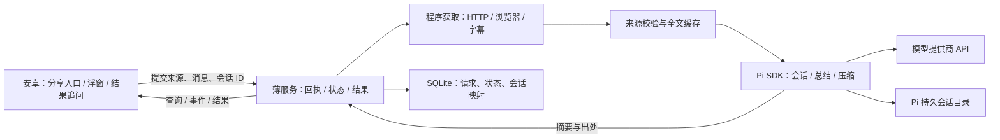

# Agent Bubble：自用 Personal Agent 架构与框架选择

日期：2026-10-08。本稿按用户明确的新范围收敛：自用、尚无现成 Personal Agent、先选轻量内核，文章与 B 站等国内视频总结优先。本文保留选型时的建议与核验记录；现已实施原生安卓 + Fastify + Pi SDK 的 MVP，运行与验收状态以 [README](../README.md) 和 [MVP 验证记录](mvp-validation.md) 为准。已完成真实 DeepSeek API、Android 15 模拟器与 Redmi K60 真机验证。当前文章工作流由程序先获取和校验来源，Pi 只负责模型会话、总结与追问，见 [文章工作流验收](article-workflow-validation.md)。此前产品与后端文档保留为扩展方向。

## 1. 产品目标与首版需求

2026-10-09 补充：当前实现属于阅读工作流 + 会话式 LLM，coding-agent 内核不是功能成立的必要条件；保留已运行的 Pi 适配器是为了复用会话基础设施。MVP 后扩展的判断见 [工作流与 Agent 的边界](workflow-agent-boundary.md)。

定位为 **把当前阅读或观看内容交给个人 Agent 的安卓入口**。文章总结、视频总结是可替换的 workflow/skill；产品自身要做好上下文交接、提交后的后台执行、结果取回与连续追问。

首版闭环：

1. 在文章或 B 站中使用系统分享，将链接/文本交给 Agent Bubble；也能从气泡输入、粘贴或选择文件。
2. 确认来源与要求后提交，看到“待发送”或服务器已接收的回执；浮窗收起后，已接收的任务继续执行。
3. 在结果浮窗看短摘要、出处和视频时间戳，需要时展开正文。
4. 在同一个来源的会话里继续问“解释这一段”“这与前一篇有什么联系”等问题。
5. 来源获取失败时说明缺少正文、字幕或登录状态，不把标题与简介冒充全文总结。
6. 手机断网或进程退出后，重新打开能取回已保存的结果；任务执行不依赖手机保持连接。

默认总结整篇文章/整个视频。首版不保证获取其他 App 的当前播放位置；“总结我已经看过的部分”需要链接时间参数或用户给出的范围。视频首版主要总结字幕中的讲述内容，画面、图表和操作演示需要额外图像输入。

悬浮气泡与结果/追问面板保留；任务列表只需最近会话与状态，不必成为复杂任务管理系统。分享入口应与浮窗同等优先：**浮窗方便唤起，但系统分享更可靠地交付来源**。Android 的 ACTION_SEND 支持文本和附件；仅拥有悬浮权限不会自动取得目标 App 的完整页面。[Android 分享接收文档](https://developer.android.com/develop/ui/compose/sharing/receive)

## 2. 现成内核的客观比较

| 方案 | 可以复用 | 我们仍需负责 | 对当前需求的判断 |
| --- | --- | --- | --- |
| 普通 OpenAI SDK 调用 Responses | 模型请求、流式响应、平台工具接口 | 本地工具执行与循环、内容获取、应用服务与会话策略 | 能完成简单摘要，但仅这种调用方式不等于已有完整 harness |
| OpenAI Agents SDK | Agent 循环、工具、流式执行、session 接口等 | 工具实现、部署、持久存储与上下文策略配置、手机连接 | 通用工具工作流的合理选择，特别是以后选择 Python 实现时 |
| Pi 的完整 coding-agent SDK | 持久会话、工具循环、自动压缩、模型配置、skills/extensions、事件与取消 | 手机服务、正文/字幕工具、任务回执与结果保存 | **优先验证**；满足“不自行组合完整 harness”的诉求 |
| Codex SDK / app-server | 现成 harness、线程恢复、流式事件、工具与执行边界 | 产品服务、内容工具、来源交接与结果回传 | 正式且可用；未来侧重文件、脚本、电脑工作区时更有吸引力 |
| OpenAI Agents API | OpenAI 托管的 Codex harness、持久 session、压缩、恢复与事件 | 手机入口、接入服务、工具和执行环境配置 | 自托管维护少，但依赖托管平台；当前文档为 beta，需核实账户权限与费用 |

SDK 和托管服务要分清：Agents SDK 的 runner 在我们的应用中执行；Agents API 的 harness 由 OpenAI 托管。普通 OpenAI SDK 也能调用 Agents API，是否有现成 harness 取决于使用的服务，不取决于包名。[OpenAI 官方运行时比较](https://developers.openai.com/api/docs/guides/agents)、[Agents SDK](https://developers.openai.com/api/docs/guides/agents/sdk)、[Agents API 概览](https://developers.openai.com/api/docs/guides/agents-api/overview)

Agents SDK 已有 session 机制，无需手写消息拼接；仍需选择持久化与上下文管理方式。官方示例中 JavaScript 的 MemorySession 与 Python 的 SQLiteSession 不是相同的持久化承诺。[Running agents](https://developers.openai.com/api/docs/guides/agents/running-agents)

Codex 应通过公开 SDK 或 app-server 集成，不必改 Rust 内核或操作桌面 UI。SDK 可重复调用或恢复 thread；app-server 面向产品集成，提供线程、turn、事件和审批协议。首版若选 app-server，使用服务端本地 stdio 桥接；当前文档标记 TCP WebSocket transport 为实验且不支持，不直接开放给手机。[Codex SDK](https://learn.chatgpt.com/docs/codex-sdk)、[Codex app-server](https://learn.chatgpt.com/docs/app-server)、[官方 harness 集成说明](https://developers.openai.com/blog/codex-as-a-platform)

以上适配排序属于工程判断，不是质量排名。Codex 的文件、命令、工作目录与执行策略带来能力，也带来配置；Pi 的完整 SDK 比 agent-core 更省组合工作。仅做固定摘要未必需要动态规划，但选现成内核可为跨来源追问与以后扩展工具保留能力。首版不同时集成三套内核，也不叠加 LangGraph 管理同一套会话。

## 3. 暂定框架与部署

建议先验证 **Kotlin + Jetpack Compose / Node.js + TypeScript + Fastify / Pi coding-agent SDK / SQLite + 文件目录**。

| 部分 | 暂定选择 | 理由 |
| --- | --- | --- |
| 安卓界面 | Kotlin、Jetpack Compose | 原生处理浮窗、分享、权限和应用生命周期；复用同一结果/输入组件 |
| 安卓缓存 | Room，按需加入 | 保存提交回执与最近结果；模型会话的权威记录仍在后端 |
| 手机到服务 | HTTP JSON；打开面板时可用 SSE | 提交、查询和取消先做好；流式连接只用于展示进度 |
| 接入服务 | Node.js、TypeScript、Fastify | 与 Pi SDK 同进程，减少跨语言服务；Fastify 负责 HTTP 路由和参数校验 |
| Agent 内核 | Pi coding-agent SDK | 复用完整会话与压缩，限定工具并替换默认提示 |
| 应用元数据 | SQLite | 保存手机请求、runtime session 映射、运行状态和结果索引 |
| 内容与产物 | 本地目录 | 正文、带时间戳字幕、摘要 Markdown；便于查看与备份 |
| 文章工具 | fetch + Mozilla Readability + jsdom + Playwright + Electron | 程序先获取 / 渲染和校验正文，再提交给模型；知乎使用独立 Electron 会话，其他站点使用 Playwright |
| B 站工具 | yt-dlp 子进程 | 复用现有站点 extractor、字幕和媒体处理能力 |
| 无字幕后的转写 | 音频获取 + FFmpeg + ASR 服务 | 第二阶段按实际需求接入；可使用现成转写 API或本地转写工具 |

这是组件取舍建议，并非已验证的软件组合。[Compose](https://developer.android.com/develop/ui/compose/documentation)、[Fastify](https://fastify.dev/docs/latest/)、[Readability 的 Node 示例](https://github.com/mozilla/readability#usage)、[yt-dlp](https://github.com/yt-dlp/yt-dlp)。若后续更适合 Python，文章抽取可选 [Trafilatura](https://trafilatura.readthedocs.io/en/latest/)，同时可比较 Agents SDK；不必为了文章抽取再部署一个完整 Python Web 服务。

图中的模块可以处于同一个服务进程；yt-dlp、可选 FFmpeg 与浏览器是受管理的工具子进程。首版无需独立调度集群、Redis 队列、Postgres、向量数据库或多 Agent 协作。

运行位置先选**个人电脑或一台常开服务器**：调试可在电脑上，全天使用需常开主机。LLM 使用 API时不必为模型推理配 GPU；本地 ASR 的资源另算。手机负责交互、提供来源和短时上传，网页抓取、字幕下载与 Agent 执行在主机上。已有可用主机时无需先购买云资源。

## 4. Pi 的使用边界

这里的 Pi 按原 `badlogic/pi-mono` 项目理解。本轮旧地址跳转到 `earendil-works/pi`，当前 SDK 文档采用 `@earendil-works/pi-coding-agent`。实施时应固定一个版本，核对该版本声明，不混用旧包名和当前 main 的示例。许可与社区核验见 [Pi 调研](pi-runtime-research.md)。

使用完整 coding-agent SDK，不从 agent-core 开始组合。SDK 可配置持久 SessionManager，订阅消息、工具和运行事件，并控制 active tools、资源和提示。当前固定阅读工作流直接由程序获取并缓存正文 / 字幕，将全文放入模型输入，工具列表为空。Pi 承担会话、流式生成、取消与上下文压缩；获取流程不依赖模型工具决策。[Pi SDK](https://github.com/earendil-works/pi/blob/main/packages/coding-agent/docs/sdk.md)

若未来后端选择 Python，或需要把 Agent 隔离为独立进程，可通过 Pi RPC 桥接。RPC 是 stdin/stdout JSONL，不是部署好的 HTTP 服务。[Pi RPC](https://github.com/earendil-works/pi/blob/main/packages/coding-agent/docs/rpc.md)

Pi 存 session 与压缩上下文；薄服务存手机任务与结果。不要再建立一套同样的聊天 history/compaction 来覆盖它。原文、字幕和时间戳单独保存，供追问重新读取；上下文压缩不是资料库，压缩摘要也不能取代完整来源。

**持久会话不等于工具断点续跑。** 首版主机重启后可恢复聊天和已有结果；中断的下载/转写标记为中断，重试时复用已完成的来源缓存。Pi 的 follow-up 排队也不能替代持久任务回执。

## 5. 薄服务最小职责

只做现成内核和手机之间必须有的连接：

- **身份和接收**：单用户连接凭据；每次提交带 clientRequestId，同一提交重试不新建重复任务。来源上传完成、请求已持久化后，返回 taskId 与 conversationId。
- **会话映射**：conversationId 对应 Pi session；通常一篇文章/一个视频一条会话，同一来源的追问继续同一 session。个人偏好独立保存并加载，不把所有文章塞进一个无限聊天。
- **后台执行**：任务运行与 HTTP/SSE 连接分离。断网或收起浮窗不调用 abort；显式取消才调用内核取消并终止对应工具子进程。同一会话先串行执行。
- **结果取回**：保存状态、最终摘要和产物路径。手机重连先查持久结果，不依赖一条曾经断开的流式连接。首版可只持久化关键进度与最终结果。
- **有限恢复**：接收但未执行的请求可在重启后继续；正在执行的任务审查已保存状态后标记中断/可重试，不承诺任意 shell 或下载自动从断点继续。

建议接口：

| 接口 | 用途 |
| --- | --- |
| `POST /tasks` | 提交来源和消息；有 conversationId 时为同一会话追问 |
| `GET /tasks/:id` | 查询状态、摘要、来源与产物 |
| `GET /conversations/:id` | 读取会话与历史结果，通过桥接查询内核历史 |
| `POST /tasks/:id/cancel` | 显式停止 |
| `GET /tasks/:id/events` | 可选流式进度；不是后台任务的生命线 |

状态至少区分手机“待发送”、服务器 queued/running、需要补充来源、completed、failed、interrupted/cancelled。任务已接收后，运行监督可以先用服务内一个串行执行器；SQLite 提供回执与状态，操作系统负责服务重启，不另建调度平台。

LLM API key 放主机配置；安卓只持有访问自己服务的凭据。B 站 Cookie 是站点凭据，与 LLM key 分开保存，不作为模型上下文发送。第一版的手机后台到达通知取决于系统推送通道与机型；先保证重新打开可取回结果，再选适合自用手机的通知方案，不以常驻 SSE 保证被系统杀进程后的提醒。

## 6. 总结 skill 与采集工具

skill 负责摘要结构、引用规则和追问方法；程序负责真实取得内容及错误处理。**一份 SKILL.md 不能凭空获得当前 App 的正文、登录态或视频。**

首批可提供两个 skill：

- `summarize-article`：取得正文，给出短摘要、关键论点、例证/限制与原文来源；追问时重新读取相关段落。
- `summarize-video`：优先字幕，保留时间戳，生成章节与要点；缺少字幕时说明情况，按已配置能力进入转写。

来源接口交付 sourceId、全文、元数据与获取方法。当前来源上限 300,000 字符，服务缓存全文并在每轮交给模型，减少追问重复抓取；超过范围则返回补充输入提示。原文视为待分析数据，不赋予其修改工具权限、系统提示或读取凭据的能力。

文章路径：分享文本可直接处理；分享链接则在服务器抓取并抽取正文。登录页或动态页面可能需要单独配置会话或浏览器；失败时提示分享正文/选中段落。截图 OCR 只覆盖截图范围，不能称为全文摘要。

B 站路径：

1. 接收分享文本，提取与解析短链接，确认 BV/AV、分 P 或集数。
2. 用 yt-dlp 获取元数据与可用字幕；优先只取字幕，避免下载完整视频。项目提供字幕选项与 `--skip-download`。[官方选项](https://github.com/yt-dlp/yt-dlp#subtitle-options)
3. 部分字幕需要登录。yt-dlp 当前 B 站 extractor 明确检测 `need_login_subtitle` 并给出登录提示；服务器需要独立配置授权会话，不能假定拿到手机 App Cookie。[B 站 extractor 源码](https://github.com/yt-dlp/yt-dlp/blob/master/yt_dlp/extractor/bilibili.py)
4. 没有字幕时，第二阶段再支持可获取音频的转写，或用户提供文件；不能仅靠简介补出整段讲述。站点支持列表不是每个视频都能获取的保证，需对常看视频实测。[支持站点列表](https://github.com/yt-dlp/yt-dlp/blob/master/supportedsites.md)
5. 保存字幕方法、语言、分 P、时间戳与缓存版本；结果标注“基于字幕”或“基于转写”。自动字幕可能有错，视觉内容另行处理。弹幕和评论不默认当作讲述正文。

录屏/录音不是通用后备通道。Android Playback Capture 需要用户授权，且目标 App 的播放类型和 capture policy 允许；先做链接/字幕路径。[Android 播放捕获](https://developer.android.com/media/platform/av-capture)

## 7. 实施顺序与选型验证

先验证两个最不确定的环节，再开发完整浮窗：

1. **内容获取验证**：收集平时实际看的文章与 B 站视频，包含短链接、多 P、有字幕、需要登录及无字幕等样本，记录正文/字幕覆盖率和失败原因。
2. **内核验证**：固定 Pi 版本，只注册首批工具；验证总结、同会话追问、保存后重启恢复、长会话压缩、取消和实际 API用量。成本以这些任务的调用记录判断，不预设哪个内核更便宜。
3. **最小接入服务**：做持久接收、单会话串行、结果查询与取消；确认关掉客户端后服务继续执行，重复提交不重复运行。
4. **安卓闭环**：先系统分享与结果页，再接悬浮气泡、结果追问面板和机型适配。单次交办应直接利用分享的来源，不让用户重新解释正在看的内容。
5. **实际使用后扩展**：看无字幕需求频率再接 ASR，看动态文章失败比例再接 Playwright，看提醒需求再接推送。需要自动操作手机时另开验证，不让它成为首版前置条件。

Pi 若在目标模型的工具调用、提示定制、恢复或版本兼容上表现不合适，则改选 Agents SDK；若日常需求逐步以文件/脚本/电脑工作区为中心，则优先重新比较 Codex app-server。当前只需要一层实际内核连接代码，无需提前建设多内核插件平台。

首版验收围绕使用效果：常看来源能取得真实内容；离开界面后已接收任务能完成；返回能看结果并继续问；失败能清楚解释原因；追问不反复下载相同来源。已有样本结果见验收文档，不承诺全平台覆盖或任意 App 一键读取。
